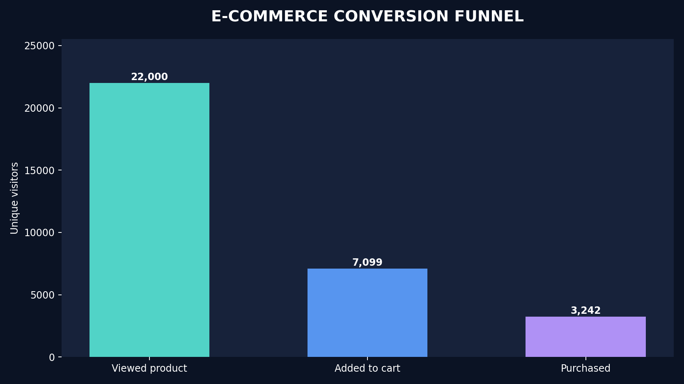

# E-commerce Conversion Funnel Analysis




**Portfolio project 1/3 · SQL + Python + interactive dashboard**

## Business problem
Why do users who view products fail to finish a purchase? Identify the biggest leak between a product view, an add-to-cart event and a completed transaction.

## Included (all runnable)
- `data/raw/events.csv`: **synthetically generated demo events** matching the Retailrocket schema (NOT real customer data).
- `scripts/generate_demo_data.py`: reproducible demo-data generator (seed 42).
- `sql/funnel.sql`: readable chronological funnel query executed using SQLite.
- `scripts/analyze.py`: data validation, SQL execution, stage conversion metrics, cohort trends.
- `outputs/dashboard.html`: interactive **offline** dashboard—double-click to open.
- `outputs/overview.png`: shareable static chart.
- `outputs/metrics.json`, `outputs/monthly_funnel.csv`, `outputs/visitor_funnel.csv`, `outputs/insights.md`: deliverables.
- `tests/test_analysis.py`: deterministic unit tests.
- `notebooks/analysis_walkthrough.ipynb`: notebook walkthrough.

## Run

```bash
python -m pip install -r requirements.txt
python scripts/generate_demo_data.py        # optional: regenerate demo CSV
python scripts/analyze.py
python -m unittest discover -s tests -v
```

Open `outputs/dashboard.html` in Chrome or another browser. The dashboard needs no running server or internet connection.

## Use the real dataset instead

1. Visit [Retailrocket E-commerce dataset](https://www.kaggle.com/datasets/retailrocket/ecommerce-dataset).
2. Download the ZIP, extract `events.csv` (large file).
3. Run `python scripts/analyze.py --data /absolute/path/to/events.csv`.
4. Output is replaced with real-data results. **Delete / move synthetic deliverables when switching datasets**; run the command again to regenerate all outputs.

Columns required: `timestamp` (Unix ms), `visitorid`, `event` (`view`, `addtocart`, `transaction`). The extra `itemid` and `transactionid` columns are allowed. Installing SQLite separately is not necessary.

## Metrics and design choices
- The visitor funnel uses **chronological progression**: first view, then any later cart, then any later transaction. Not a same-item or same-session funnel.
- Viewer cohort months use time of first qualifying view. Later cohorts have less follow-up time (right censoring).
- Stage conversion = people who reached next stage / people who reached current stage.
- This is **diagnostic, not causal**. A recommendation is a hypothesis for future experimentation, not measured lift.

## Talking points for interviews
1. Why chronological SQL joins prevent purchase-before-cart counting.
2. What makes event-level logging different from unique-visitor funnel metrics.
3. Why a huge drop-off is not proof that a specific UI element is broken.
4. How you would validate the hypothesis with an A/B test.

**Dataset credit:** Retailrocket, Kaggle. The bundled CSV is original **synthetic demo** data and is not copied from Retailrocket. No marketing lift is claimed.

**Resume suggestion (after you understand and run the work):** “Built a SQL-based three-stage e-commerce conversion funnel and offline Plotly dashboard, tracking viewer-to-cart and cart-to-purchase rates with month-level cohorts.”

## Optional one-command public dataset download

Requires internet and dataset access; the bundled synthetic demo works without this. Run `python -m pip install "kagglehub>=1.0.3"`, then `python scripts/download_real_data.py`, then:

```bash
python scripts/analyze.py --data data/real/events.csv
```

The download helper saves data under `data/real/` to preserve your demo input. The downloader cannot be network-tested in this package environment.
